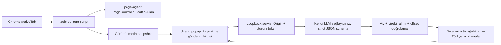

# Koşul Gözcü

Chrome MV3 uzantısı: görünür kullanım/abonelik metnini yakalar, şemalı LLM çıktısını doğrular, kaynak alıntılarıyla sade Türkçe risk raporu sunar. **Bu uygulama hukuki tavsiye vermez.**

## Teslim durumu

- Uzantı paketi ve yerel analiz servisi hazır; build ve çekirdek testleri çalıştırıldı.
- 5 gerçek ToS snapshot'ı üzerinde mini eval: `eval/REPORT.md`. Bu eval **demo baseline** içindir; canlı LLM evali değildir.
- LLM anahtarı mevcut olmadığı için canlı LLM çağrısı doğrulanmadı. Alibaba demo servisi kullanılmaz.
- Cypress senaryosu mutlu yol, gizli injection ve dürüst belirsizlik anını içerir. Windows çalıştırma sonucu `SECURITY.md` / `DELIVERY.md` içinde belirtilir. MP4 dosyası yoksa kayıt teslim edilmiş sayılmaz.
- GitHub hedefi `mervebeyazal/kosul-gozcu`; uzaktan repo oluşturulması giriş gerektirir.

## Kurulum

Node 24+, Chrome. Proje dizininde:

```powershell
npm ci
npm run build
Copy-Item .env.example .env
```

`.env` dosyasına kendi sağlayıcınızın `LLM_API_KEY`, `LLM_URL`, `LLM_MODEL` değerlerini girin. OpenAI uyumlu chat completions + strict JSON schema desteği gerekir. Anahtar yalnızca servis ortamında bulunur. Kod veya tarayıcı depolamasına koymayın.

1. `chrome://extensions` → Geliştirici modu → Paketlenmemiş öğe yükle → `extension/` klasörü.
2. Uzantı kimliğini `.env` içindeki `EXTENSION_ID` değerine yazın.
3. `npm start`; servis yalnızca `127.0.0.1:4317` üzerinde dinler.
4. Koşullar sayfasında uzantıyı açın → Açık sayfayı yakala → metni gözden geçirin → Analiz et.
5. Anahtarsız deneme: yöntem listesinden açıkça etiketlenmiş Demo modu. Yerel fixture: `http://127.0.0.1:4317/demo.html`.

Gizli API anahtarını sohbete veya repoya yüklemeyin. `.env` Git dışında bırakılmıştır.

## Mimari ve veri akışı



Alibaba `page-agent@1.12.4` paketinin `@page-agent/page-controller` modülü sayfada DOM'u okur. `PageAgent.execute` çağrılmaz; modelin tıklama, form doldurma veya ağ aracı yoktur. PageController'ın biçimlendirilmiş DOM çıktısı kanıt olarak kullanılmaz: birebir alıntılar ayrıca yakalanmış görünür kaynak metninde aranır. Bu tercih ajanın metin okuma altyapısını kullanırken aksiyon yetkilerini analiz hattından çıkarır.

Metin nav/header/footer, script/style, gizli alanlar ve form kontrollerinden arındırılır. `main/article` tercih edilir, yoksa body. 120.000 karakter sınırı, iframe veya kısa metin → kısmi kapsam → skor null. PDF, kapalı shadow DOM, sayfaya henüz yüklenmemiş koşullar ve iframe metni desteklenmez. Görünür DOM yakalama belgenin tamamlandığını garanti etmez. Otomatik tüm site izleme yoktur: kullanıcı `activeTab` ile yakalamayı başlatır; böylece tüm sitelere sürekli erişim istenmez.

## Çıktı sözleşmesi

Model yalnızca `{ "uncertain": boolean, "risks": [{ "category": enum, "quote": string }] }` üretir. Ek alanlar reddedilir. Schema `src/core.js` içinde tek kaynaktır ve hem sağlayıcı hem Ajv tarafından kullanılır. Her alıntı kaynakta birebir ve kesintisiz bulunmalıdır; uydurma tek alıntı tüm raporu reddettirir. Offset'ler JavaScript UTF-16 birimleridir. Eşit alıntının ilk geçtiği yer kullanılır.

Skor modelden alınmaz: kategori ağırlıkları 18/16/22/14/14/16, kategori başına bir kez, üst sınır 100. Skor hukuki olasılık, zarar tutarı veya hukuki geçerlilik tahmini değildir. Belirsizlik veya kısmi kapsam varsa kesin skor yoktur; gözlenen ağırlık ayrı JSON alanıdır. Türkçe açıklamalar modelin serbest metni yerine sabit, ihtiyatlı kategori açıklamalarıdır. Alıntı varlığı semantik doğruluğu ispatlamaz; bu sınır UI'da ve evalde belirtilir.

## Doğrulama

```powershell
npm test
npm run eval
node fixtures.mjs
npm start
# Ayrı terminalde:
npm run demo
```

Cypress videoyu `cypress/videos/demo.cy.js.mp4` olarak kaydeder. Senaryo iki ekran ve yaklaşık 7 saniye okuma beklemesi içerir; üretilmiş dosyanın süre kontrolü ≤90 saniye olmalıdır. Fixture demo etiketini taşır; gerçek LLM demo diye sunulmaz. Cypress normal tarayıcı sayfasında aynı extractor/UI/servis kodunu çalıştırır; Chrome MV3 paketinin yüklenmesi manuel kabul kontrolüdür.

Eval yeniden indirme: `node eval/fetch.mjs`; sonra `npm run eval`. Kaynak hash ve erişim tarihi `eval/manifest.json` içinde. Kaynak dosyalar yerel teslimde var; üçüncü taraf sözleşme metinleri Git'e eklenmez. Güncel kaynak değişirse gold çapaları başarısız olabilir; etiketi sessizce değiştirmeyin.

## GitHub'a teslim

GitHub girişi sonrası boş `mervebeyazal/kosul-gozcu` reposu oluşturun. Yerel repo hazırlandıysa:

```powershell
git remote add origin https://github.com/mervebeyazal/kosul-gozcu.git
git push -u origin main
```

Canlı LLM mini evali, gerçek LLM ile prompt injection denemesi, bağımsız gold anotasyon ve Chrome'da uzantı kabul testi tamamlanmadan üretim için hazır sayılmamalıdır. Gizlilik metinlerinde veri satışı, sınır ötesi aktarım ve saklama süresi kategorileri bu MVP'de bulunmaz.
